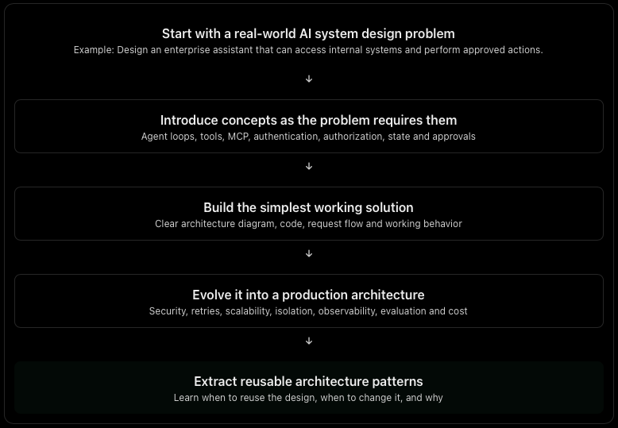

# **Agentic AI — Learning Roadmap**

`Architecture + hands-on projects`

**Goal:** Become capable of building production-grade Agentic AI systems,
including MCP, multi-agent orchestration, Generative UI, MCP
Apps, and enterprise integrations.

Learn the fundamentals, build working examples, and then study specific
frameworks.

- MCP and A2A are open interoperability protocols.
- LangGraph, OpenAI Agents SDK, and Google ADK are implementation frameworks.
- MCP Apps and AG-UI address different parts of the user-interface architecture.

Do not start with complex multi-agent systems. Most learning should begin
with a single agent, well-defined tools, explicit workflows, and reliable state
management. Add agents only when there is a clear architectural reason.

## **Architecture topics to prioritize**

The following ranking balances long-term architectural value with current
industry developments.

| Priority | Architecture / standard                     | Why learn it                                             |
|----------|---------------------------------------------|----------------------------------------------------------|
| P0       | Agent fundamentals and workflow patterns    | Foundation for every agentic solution                    |
| P0       | **MCP**                                     | Standardized access to tools, APIs, and data             |
| P0       | **MCP Apps**                                | Interactive HTML interfaces embedded in AI conversations |
| P0       | Stateful agent orchestration                | Reliable, resumable, human-approved workflows            |
| P1       | **Generative UI and AG-UI**                 | Real-time, interactive agent-to-frontend experiences     |
| P1       | **A2A protocol**                            | Interoperability between independent agent systems       |
| P1       | RAG, context engineering, memory            | Grounded answers and controlled context                  |
| P1       | Enterprise agent security and observability | Production readiness                                     |
| P2       | Agent Skills, agent harnesses, MCP Tasks    | Emerging reusable and long-running agent patterns        |
| P2       | Computer-use and multimodal agents          | Advanced autonomous workflows                            |

## **Your learning plan**

**Learning tracker**

### 01 - Agent foundations

LLMs, structured output, tool calling, agent loops, deterministic workflows vs
autonomous agents.

**Deliverable:** Build a single-agent assistant with two tools and clear
stopping rules.

### 02 - Agent architecture patterns

Routing, ReAct-style loops, planner-executor, supervisor-worker, parallelism,
handoffs and error recovery.

**Deliverable:** Draw four architecture diagrams and implement a routed
workflow.

### 03 - MCP fundamentals

Host/client/server roles, tools, resources, prompts, JSON-RPC, local and remote
transports.

**Deliverable:** Build an MCP server and connect it to an agent.

### 04 - Enterprise MCP

OAuth, the least privilege, tool schemas, trust boundaries, gateways, protocol
versions and scalable deployment.

**Deliverable:** Secure your MCP server and test unauthorized tool access.

### 05 - Stateful orchestration

Graphs, checkpoints, retries, idempotency, durable execution, human-in-the-loop.

**Deliverable:** Create a resumable agent workflow with an approval step.

### 06 - RAG, context and skills

Hybrid retrieval, grounding, session and long-term memory, context compaction,
Agent Skills.

**Deliverable:** Add a document knowledge base, citations and one reusable
SKILL.md.

### 07 - Generative UI

Structured UI output, component schemas, frontend rendering, streaming, UI
validation and state ownership.

**Deliverable:** Make the agent produce an interactive HTML results dashboard.

### 08 - MCP Apps

UI resources, tool-to-UI metadata, iframe isolation, host bridge, app-only tools
and fallback.

**Deliverable:** Turn the dashboard into a standards-based MCP App.

### 09 - AG-UI

Event streams, tool events, state snapshots/deltas, interrupts and bidirectional
interaction.

**Deliverable:** Create an agent-connected web UI with live progress and
approvals.

### 10 - Multi-agent interoperability

A2A discovery, Agent Cards, task lifecycle, delegation, external agent
boundaries.

**Deliverable:** Connect a second independently deployed agent through A2A.

### 11 - Production architecture

Evaluation, tracing, OpenTelemetry, prompt injection, authorization, rate
limits, cost and latency.

**Deliverable:** Add tests, traces, threat model and operational controls.

### 12 - Architecture capstone

Trade-off analysis, deployment options, scaling, failure modes and architecture
reviews.

**Deliverable:** Deliver a full working solution, diagrams, architecture
decision records and an evaluation report.

## **Which frameworks should you learn?**

Do not attempt to master every framework.
Choose one primary framework, then study others to understand their differences.

| Framework                 | Focus                                                 | My suggested use        |
|---------------------------|-------------------------------------------------------|-------------------------|
| OpenAI Agents SDK         | Lightweight agent execution, tools, handoffs, tracing | First working agent     |
| LangGraph                 | Explicit state graphs, checkpoints, durable workflows | Deep architecture study |
| Microsoft Agent Framework | Agents, graph workflows, enterprise integrations      | Microsoft ecosystem     |
| Google ADK                | Multi-agent composition and workflow orchestration    | Google Cloud ecosystem  |

These distinctions are supported by each framework's official documentation.
(https://www.google.com/s2/favicons?domain=https://openai.github.io\&sz=32)

**Suggested stack:**
Python for agent orchestration, Python for MCP where needed,
plain HTML/CSS/JavaScript for the UI, and PostgreSQL for application state.

Use LangGraph for your main durable-workflow exercise.

You can build the MCP App UI with/without React.

## **Official learning resources**

These are the core sources I would follow rather than general tutorials.

| Topic               | Official resource                                                                                                               |
|---------------------|---------------------------------------------------------------------------------------------------------------------------------|
| MCP                 | [MCP documentation and specification](https://modelcontextprotocol.io/?utm_source=chatgpt.com)                                  |
| MCP Apps            | [MCP Apps specification and SDK](https://github.com/modelcontextprotocol/ext-apps?utm_source=chatgpt.com)                       |
| MCP App in ChatGPT  | [Official MCP server and UI quickstart](https://developers.openai.com/plugins/build/app-quickstart?utm_source=chatgpt.com)      |
| AG-UI               | [AG-UI protocol](https://github.com/ag-ui-protocol/ag-ui?utm_source=chatgpt.com)                                                |
| A2A                 | [A2A v1.0 documentation](https://a2a-protocol.org/v1.0.0/?utm_source=chatgpt.com)                                               |
| Agent orchestration | [LangGraph](https://docs.langchain.com/oss/python/langgraph/overview?utm_source=chatgpt.com)                                    |
| Agent Skills        | [Agent Skills specification](https://agentskills.io/?utm_source=chatgpt.com)                                                    |
| Security            | [OWASP Agentic Top 10](https://genai.owasp.org/resource/owasp-top-10-for-agentic-applications-for-2026/?utm_source=chatgpt.com) |
| Observability       | [OpenTelemetry GenAI conventions](https://github.com/open-telemetry/semantic-conventions-genai?utm_source=chatgpt.com)          |

**A version detail worth noting:**
MCP's July 28, 2026 specification introduced a stateless protocol core and
official extensions framework.

Older tutorials may still show the earlier session-based handshake. Learn
both, but design new systems against the supported capabilities of your actual
clients and servers.

(https://www.google.com/s2/favicons?domain=https://blog.modelcontextprotocol.io\&sz=32)

## **Capstone: build one enterprise reference architecture**

I suggest an **Agentic IT Operations Assistant** because it lets you combine all
the architectures into a single realistic solution.

## **IT Operations Assistant**

A mock enterprise incident-management system with intelligent investigation,
recommended actions, and human approvals.

**Agent runtime:**
Investigate incidents and coordinate steps

**MCP servers:**
Query tickets, metrics and runbooks

**MCP App:**
Display incident details and actions

**AG-UI:**
Stream progress and approval state

**A2A agent:**
Delegate root-cause research

**Safety + evaluation:**
Audit, approve, trace and test

At the end, you should have a working demo plus a professional architecture
package: component and sequence diagrams, API and protocol contracts, deployment
design, security and trust boundaries, architecture decision records (ADRs), and
evaluation results.

## **How to measure your progress**

You should be able to answer these questions without relying on
framework-specific examples:

- When should a workflow use deterministic code instead of an autonomous agent?
- When should you use MCP rather than a direct API call?
- When should you use MCP Apps versus AG-UI?
- When is A2A justified instead of an internal agent handoff?
- Where should application state, agent memory, and UI state live?
- How do you secure agent actions across trust boundaries?
- How do you recover from interrupted execution and test agent quality?

The target is not simply to know how to use SDKs. It is to **defend architecture
decisions using trade-offs, working implementations, and evidence**.

For the strongest result, spend as much time documenting *why* you chose an
architecture as you spend implementing it.

## Learning method

The key is to learn MCP by designing systems that need MCP, learn Generative UI
by building interactive AI products, and learn multi-agent patterns by solving
problems where a single agent is insufficient.

### Coverage

1. Agent fundamentals and application patterns
2. MCP, tool servers and integrations
3. RAG, context engineering and memory
4. Agent orchestration and durable workflows
5. Generative UI, MCP Apps, AG-UI and A2UI
6. Multi-agent architecture and A2A
7. Enterprise security and identity
8. Evaluation, reliability and operations
9. Advanced agentic architectures
