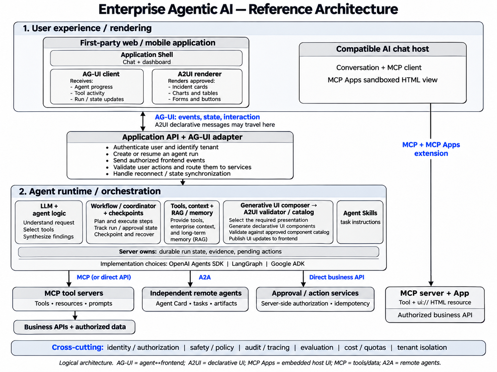

## **Understand how the architectures fit together**

These are complementary architecture layers, not competing technologies.

### Where each technology fits

`Agents SDKs, LangGraph, etc. -> Agent execution and coordination`

| Technology    | Concern                                                | Example                                                          |
|---------------|--------------------------------------------------------|------------------------------------------------------------------|
| Generative UI | Overall UI pattern - decides what to display.          | AI chooses to show a chart, table, or form instead of plain text |
| A2UI          | Declarative UI specification and renderer contract     | Agent describes an incident card using approved components       |                                         
| AG-UI         | Agent ↔ frontend/user communication                    | Streams investigation progress, state updates and UI messages    |
| MCP Apps      | Embedded application UI in a compatible AI host        | Incident dashboard appears inside the chat                       |                                                       
| MCP           | Access to external tools (Agent/host ↔ tools) and data | Read incident metrics or query tickets                           |                                                    
| A2A           | Connects independent agent ↔ agent                     | Delegate root-cause analysis to a separate specialist            |                                                         

**Important:**

1. The two top-level interfaces are alternative entry points, not two mandatory
   interfaces for every application.
    - A compatible chat host can call the MCP server directly using `MCP + MCP 
     Apps`.
    - **MCP App** is an _alternative way_ to deliver an interactive interface
      inside a compatible AI host; not another component you must place
      inside the custom web frontend.

2. **Important distinction:**
    - **A2UI** describes the interface.
    - **AG-UI** moves the information.

3. A2UI is not limited to AG-UI transport.
   It can use MCP, A2A or other supported communication mechanisms.

4. AG-UI does not require A2UI, vice versa.

### How the technologies interact

There are three main communication paths:

| Path                                  | Communication                                                                         | Why it exists                                                 |
|---------------------------------------|---------------------------------------------------------------------------------------|---------------------------------------------------------------|
| Custom frontend ↔ Agent runtime       | AG-UI carries events and state. A2UI messages can travel through the same connection. | Live interaction and dynamic, trusted UI rendering            |
| AI chat host ↔ MCP server             | MCP provides tools and data. MCP Apps adds an optional embedded HTML interface.       | Reusable tools and rich interfaces inside compatible AI hosts |
| Agent runtime ↔ External capabilities | MCP or direct APIs for tools; A2A for independent agents.                             | Data access, business operations and delegation               |

### When each becomes necessary

| Technology                   | Use when                                                                                 | Simpler alternative                          |
|------------------------------|------------------------------------------------------------------------------------------|----------------------------------------------|
| AG-UI                        | The frontend needs live agent events, synchronized state or interaction during execution | HTTP APIs or custom SSE                      |
| A2UI                         | The agent must dynamically compose UI from an approved component catalog                 | Fixed UI components with structured JSON     |
| MCP Apps                     | You want interactive HTML embedded inside an MCP-compatible chat host                    | Standard MCP tool results                    |
| MCP                          | Multiple AI hosts or agents need standardized access to tools and data                   | Direct function or API calls                 |
| A2A                          | Independent agent services need to exchange tasks and artifacts                          | Internal function calls or agent handoffs    |
| Agent Skills                 | Agents need reusable procedural instructions                                             | Application-owned instructions               |
| LangGraph / Agents SDK / ADK | You need an implementation framework for agents and workflows                            | A simple application with direct model calls |

Frameworks are **implementation choices inside the agent runtime**, not
communication protocols. For example, LangGraph focuses on stateful workflow
orchestration, while the OpenAI Agents SDK provides agent execution, tools and
handoffs. Neither requires AG-UI, MCP or A2A for every application.

### The critical design distinction

**Gen UI is a capability, not a mandatory separate infrastructure layer**.
An agent may generate structured UI descriptions; A2UI is one standardized way
to express them. AG-UI can transport those messages, but does not decide how
components are rendered.

For example, in a generic application:
`User request → Agent → MCP tool → Structured result → A2UI description → AG-UI transport → Frontend renderer`

When a user clicks a generated action button, the request returns to the
backend. The authorized business service validates identity, permissions and
current business state. The model and renderer never grant authority themselves.

If the connection drops during an action, the application should recover from
durable backend state rather than replay a potentially completed write blindly.

### Architecture recommendation:

Start with one agent, direct APIs and fixed UI components.
Add AG-UI for live interaction, A2UI for dynamic composition, MCP for reusable
tool interfaces, MCP Apps for compatible conversational hosts, and A2A for
genuinely independent agents. Each addition should solve a demonstrated
requirement rather than become part of a mandatory technology stack.

## One exact example: Incident investigation

Assume an operator asks:
> Investigate incident `INC-42`, show the findings, and
> let me approve remediation.

1. **The frontend sends the request.**

   The AG-UI client starts an agent run with `incident_id=INC-42`. The backend
   authenticates the operator.

2. **The runtime retrieves evidence.**

   The agent invokes an MCP monitoring tool. The monitoring service checks
   access to INC-42, then returns metrics and evidence identifiers.

3. **Generative UI chooses a presentation.**

   The model proposes an incident summary card, severity indicator and
   remediation form. A2UI validation checks the proposed components against the
   approved catalog.

4. **AG-UI delivers progress and UI information.**

   The frontend receives progress events and, through an integration adapter,
   validated A2UI messages such as `createSurface`, `updateComponents` and
   `updateDataModel`. The A2UI renderer draws the components.

5. **The operator requests approval.**

   Clicking the UI control sends an action to the backend. The business service
   checks identity, incident state and authorization. The UI itself cannot
   approve or execute remediation.

**Failure example:** If the operator's permission is revoked after the A2UI card
is displayed, the backend must reject the next protected action. The frontend
shows an access-denied or stale-state message rather than treating the rendered
button as proof of permission.
